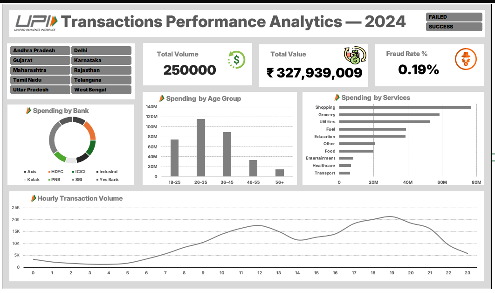

# UPI Transactions Performance Analytics — 2024

## About the Project

This is my first Excel dashboard project, where I explored a synthetic UPI transactions dataset for 2024.

I wanted to practise working with transaction data, understand the patterns in it, and present my findings in a simple interactive dashboard.

## Dashboard Preview

## What I Explored

- Total transaction volume and transaction value
- Fraud-flag percentage
- Spending by age group, service category, and bank
- Hourly transaction volume
- Filtering data by state and transaction status

## Tools Used

- Microsoft Excel
- PivotTables and PivotCharts
- Slicers
- Formulas and dashboard formatting

## What I Learned

While building this project, I practised summarising data with PivotTables, choosing charts for different comparisons, and using slicers to make the dashboard interactive. I also learned to pay attention to chart titles, KPI calculations, and how the data should be interpreted.

## Dataset

The dataset contains 250,000 transaction records across 2024 and was sourced from Kaggle.

[UPI Transactions 2024 Dataset / Generator](https://www.kaggle.com/code/skullagos5246/upi-transactions-generator)

**Note:** This is synthetic data, so the patterns in this project should not be treated as actual UPI transaction trends. A fraud flag also does not confirm that fraud occurred.

## Project Files

- `upi_transactions_analysis.xlsx` — Excel workbook containing the dataset, analysis, dashboard, and findings.
- `dashboard.png` — Dashboard preview.

